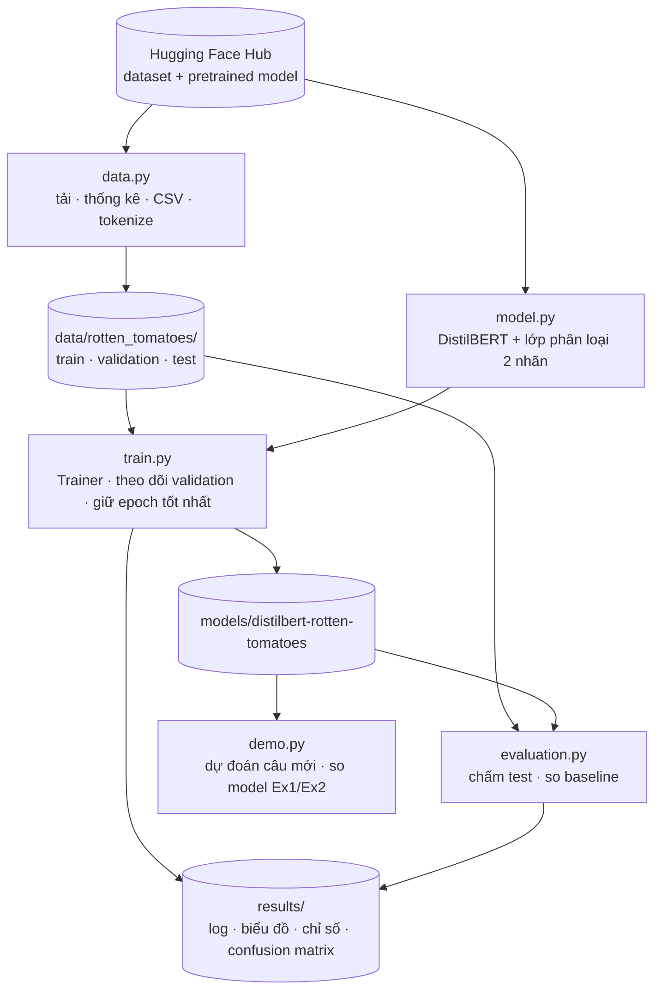

# Design — Lab 3

Thiết kế lời giải cho bài toán ở [problem-definition.md](problem-definition.md): một pipeline Hugging Face gồm 5 bước (data → model → train → evaluation → demo), có hai cách chạy là notebook (theo đúng đề) và script `src/` (lặp lại được, lưu kết quả ra file).

## 1. Kiến trúc tổng thể



`config.py` (tên model, dataset, siêu tham số, đường dẫn) được mọi module dùng chung nên không vẽ trên sơ đồ.

Notebook `notebooks/ex1_sentiment_analysis.ipynb` và `notebooks/ex2_finetuning.ipynb` thực hiện cùng các bước trong một file, đúng thứ tự yêu cầu của đề, kết quả nằm trong output của notebook.

## 2. Các module

| Module | Đầu vào | Đầu ra | Dùng |
|---|---|---|---|
| `config.py` | Biến môi trường `LAB3_*` (tùy chọn) | Hằng số: tên model/dataset, siêu tham số, đường dẫn | Mọi module |
| `data.py` | Hugging Face Hub hoặc CSV đã có | `DatasetDict` train/validation/test; `data/rotten_tomatoes/*.csv`; `results/dataset_stats.json` | `train`, `evaluation` |
| `model.py` | Tên model trên Hub hoặc thư mục model đã lưu | Tokenizer, model phân loại 2 nhãn; `results/model_summary.txt` | `train`, `evaluation`, `demo` |
| `train.py` | Dữ liệu đã tokenize, model gốc | `models/distilbert-rotten-tomatoes/` (epoch tốt nhất); `results/train_log.json`, `train_history.csv`, `loss_curve.png` | `evaluation`, `demo` |
| `evaluation.py` | Model đã lưu, tập test | `results/test_metrics.json`, `confusion_matrix.png`, `misclassified.csv` | Báo cáo |
| `demo.py` | Câu người dùng nhập; model Ex1 hoặc Ex2 | Nhãn + độ tin cậy in ra màn hình | Trình bày |

Mỗi module chạy độc lập bằng `python -m src.<tên>` từ thư mục `LAB 3`; các module giao tiếp qua file trên đĩa (`data/`, `models/`, `results/`), nên chạy lại một bước không cần chạy lại các bước trước.

## 3. Thiết kế từng thành phần

### 3.1. Dữ liệu

- Dùng nguyên 3 tập chia sẵn của `rotten_tomatoes`; không tự chia lại.
- Tokenizer WordPiece `uncased`, `truncation=True`, `max_length=128`.
- Padding động theo batch (`DataCollatorWithPadding`) thay vì pad cố định 128 token.
- Xuất CSV một lần, các lần sau đọc từ CSV để chạy được khi không có mạng.

### 3.2. Model

```
input_ids ──► DistilBERT (6 lớp Transformer, ẩn 768) ──► vector [CLS]
          ──► pre_classifier Linear(768, 768) + ReLU + Dropout
          ──► classifier Linear(768, 2) ──► logits ──► softmax ──► p(NEGATIVE), p(POSITIVE)
```

66.955.010 tham số, tất cả đều được cập nhật khi fine-tune. Hai lớp `pre_classifier`, `classifier` khởi tạo ngẫu nhiên (báo `MISSING` khi nạp).

### 3.3. Huấn luyện

| Thành phần | Thiết kế |
|---|---|
| Hàm mất mát | Cross-entropy (mặc định của `Trainer` cho phân loại) |
| Optimizer, lịch học | AdamW, learning rate 2e-5 giảm tuyến tính về 0, weight decay 0.01 |
| Batch, epoch | 16 câu/batch, 3 epoch = 1.602 bước |
| Theo dõi | Đánh giá validation sau mỗi epoch (loss, accuracy, F1) |
| Chọn model | Notebook: model cuối epoch 3. Script: lưu checkpoint mỗi epoch, giữ epoch có validation accuracy cao nhất |
| Tốc độ, bộ nhớ | fp16 khi có GPU NVIDIA |
| Tái lập | `seed = 42` cho mọi nguồn ngẫu nhiên |

### 3.4. Đánh giá

- Baseline: cùng kiến trúc nhưng lớp phân loại chưa huấn luyện, chấm trên cùng tập test.
- Accuracy và F1 bằng thư viện `evaluate` (nạp một lần, dùng bản lưu trên máy); precision, recall, báo cáo theo lớp, confusion matrix bằng `sklearn`.
- Lưu từng câu bị đoán sai kèm độ tin cậy để phân tích lỗi.

### 3.5. Demo

Một lớp `SentimentModel` bọc tokenizer + model, chạy trên GPU nếu có. Bốn chế độ: một câu với model Ex2, một câu với model Ex1, so sánh 2 model trên 5 câu mẫu (tích cực, tiêu cực, phủ định, trung tính, mỉa mai), và gõ câu liên tục.

## 4. Quyết định thiết kế và phương án đã cân nhắc

| Quyết định | Phương án khác | Lý do chọn |
|---|---|---|
| DistilBERT-base-uncased | BERT-base, RoBERTa-base | Nhỏ hơn BERT-base khoảng 40%, vừa GPU 6 GB với batch 16; cùng họ với model Ex1 nên dễ so sánh |
| Bộ `rotten_tomatoes` | IMDB (25.000 review dài) | Câu ngắn (trung bình 21 từ) nên train nhanh, kể cả trên CPU; có sẵn tập validation riêng |
| `max_length = 128` | 256, 512 | Câu dài nhất 59 từ; 128 token đủ, tốn ít bộ nhớ hơn |
| Padding động | Pad cố định 128 | Bớt tính toán thừa cho câu ngắn |
| 3 epoch, lr 2e-5 | 1–5 epoch, lr 1e-5–5e-5 | Mức thường dùng khi fine-tune BERT; 3 epoch đủ thấy overfitting để phân tích |
| Theo dõi validation, test một lần | Theo dõi trên test (bản đầu 28/10) | Tránh chọn model theo test; số liệu test khách quan |
| Script giữ epoch tốt nhất | Luôn dùng epoch cuối | Validation loss tăng sau epoch 1, accuracy cao nhất ở epoch 2 |
| Notebook + script `src/` | Chỉ notebook | Notebook bám sát đề; script lặp lại được, ghi kết quả ra file, tách theo phần data/model/training/evaluation/demo |
| Model không đưa lên GitHub | Git LFS, Hugging Face Hub | Giới hạn 100 MB/file; tạo lại chỉ mất ~2 phút |

## 5. Yêu cầu phi chức năng

| Yêu cầu | Cách đáp ứng | Kiểm chứng |
|---|---|---|
| Tái lập | Seed 42, cùng phiên bản thư viện | Lần chạy 28/10 và 04/11 cho cùng training loss và cùng kết quả test |
| Thời gian | GPU + fp16 | Train 3 epoch: 121,8 giây (notebook), 131,5 giây (script) trên RTX 3050 |
| Chạy không cần mạng sau lần đầu | CSV cục bộ, model và chỉ số lưu trên máy | `src.evaluation` chạy được khi không truy cập Hub |
| Dễ kiểm tra | Mỗi bước ghi kết quả ra `results/` | 8 file kết quả, đối chiếu với tài liệu |

## 6. Hạn chế của thiết kế

- Chỉ một model và một cấu hình siêu tham số; chưa dò siêu tham số hay chạy nhiều seed.
- Chọn model theo validation accuracy trên 1.066 câu: chênh lệch giữa epoch 2 và 3 (84.62% so với 84.52%) chỉ là 1 câu, chưa đủ ý nghĩa thống kê.
- Không có early stopping; số epoch cố định.
- Demo là dòng lệnh, chưa có giao diện hay API.
