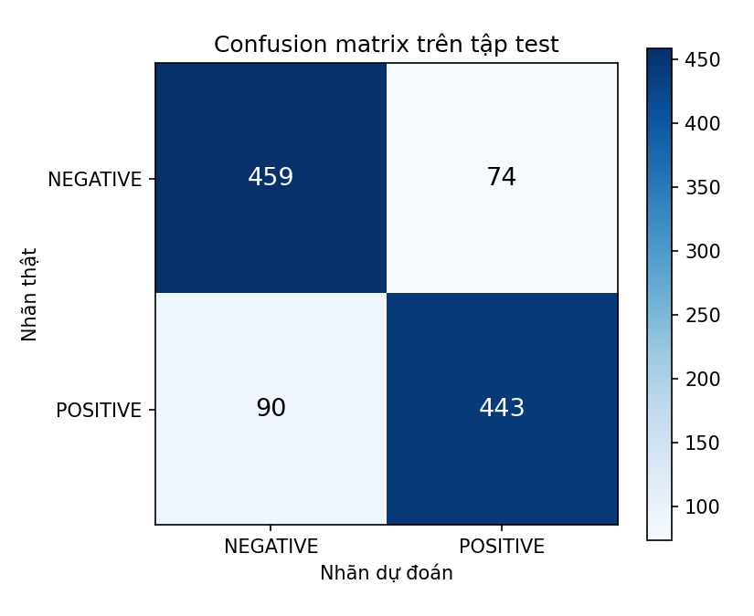

# Evaluation — Đánh giá kết quả

## 1. Chỉ số dùng

| Chỉ số | Ý nghĩa |
|---|---|
| Accuracy | Tỉ lệ câu dự đoán đúng |
| Precision (lớp POSITIVE) | Trong các câu model đoán POSITIVE, bao nhiêu câu đúng |
| Recall (lớp POSITIVE) | Trong các câu thật sự POSITIVE, model tìm ra bao nhiêu |
| F1 | Trung bình điều hòa của precision và recall |
| Confusion matrix | Hàng = nhãn thật, cột = nhãn dự đoán |
| Loss | Cross-entropy trên tập đánh giá; phản ánh cả độ tự tin của dự đoán |

Accuracy và F1 tính bằng thư viện `evaluate` (`evaluate.load("accuracy")`, `evaluate.load("f1")`). `src/evaluation.py` tính thêm precision, recall, báo cáo theo lớp và confusion matrix.

## 2. Exercise 1 — model có sẵn

| Câu | Dự đoán | Độ tin cậy | Đánh giá |
|---|---|---|---|
| I really love this movie, it was amazing! | POSITIVE | 99.99% | Đúng |
| This product is terrible, I want my money back. | NEGATIVE | 99.98% | Đúng |
| The food was okay, nothing special. | NEGATIVE | 98.34% | Câu trung tính, model chỉ có 2 nhãn nên buộc chọn một bên |
| Not bad at all! | POSITIVE | 99.96% | Đúng, hiểu phủ định "not bad" |
| Oh great, another Monday... | POSITIVE | 99.70% | Sai, không nhận ra mỉa mai |

Model đúng với câu có cảm xúc rõ và câu phủ định, nhưng sai với câu mỉa mai và vẫn tự tin trên 98% với cả câu trung tính lẫn câu đoán sai: độ tin cậy cao không đồng nghĩa với đúng.

## 3. Exercise 2 — kết quả fine-tune

### Kết quả cuối — lần 3 (04/11, GPU RTX 3050, 3 epoch, bản tách validation/test)

Theo dõi trên **validation** sau mỗi epoch; **test** chỉ đánh giá một lần, bằng model ở cuối epoch 3. Huấn luyện 1.602 bước trong 121,8 giây.

| Tập | Thời điểm | Training loss | Loss | Accuracy | F1 |
|---|---|---|---|---|---|
| Validation | Trước fine-tune | – | 0.6968 | 45.22% | 17.75% |
| Validation | Sau epoch 1 | 0.4002 | **0.3450** | 83.58% | 83.12% |
| Validation | Sau epoch 2 | 0.2297 | 0.4067 | **84.62%** | 84.32% |
| Validation | Sau epoch 3 | 0.1447 | 0.4874 | 84.52% | 84.59% |
| **Test** | Cuối epoch 3 | – | 0.5470 | **84.62%** | **84.67%** |

Kết quả này trùng từng chữ số với test của lần 1 (cùng seed 42, cùng GPU): training loss từng epoch giống hệt, nên huấn luyện **tái lập được**; việc tách validation/test chỉ đổi tập dùng để theo dõi, không đổi model.

| Nguồn | Validation trước | Validation sau | Test accuracy | Test F1 |
|---|---|---|---|---|
| Notebook, cuối epoch 3 (lần 3) | 45.22% | 84.52% | **84.62%** | **84.67%** |
| `src.train` + `src.evaluation`, epoch tốt nhất (epoch 2) | 45.22% | 84.62% | **84.62%** | 84.38% |

Script chọn **epoch 2** (validation accuracy cao nhất 84.62%). Model epoch 2 và model epoch 3 cùng đúng 902/1.066 câu test (84.62%) nhưng F1 khác nhau (84.38% so với 84.67%), vì phân bổ lỗi giữa hai lớp khác nhau.

### Đánh giá chi tiết bằng `src.evaluation` (07/11, model epoch 2, 1.066 câu test)

| Model | Accuracy | Precision | Recall | F1 |
|---|---|---|---|---|
| DistilBERT chưa fine-tune (lớp phân loại ngẫu nhiên) | 42.87% | 28.41% | 9.38% | 14.10% |
| **Đã fine-tune (epoch 2)** | **84.62%** | 85.69% | 83.11% | 84.38% |

Precision, recall, F1 tính cho lớp POSITIVE. Model chưa fine-tune có recall chỉ 9.38%: gần như luôn đoán NEGATIVE.

Theo từng lớp:

| Lớp | Precision | Recall | F1 | Số câu |
|---|---|---|---|---|
| NEGATIVE | 83.61% | 86.12% | 84.84% | 533 |
| POSITIVE | 85.69% | 83.11% | 84.38% | 533 |

Confusion matrix (hàng = nhãn thật, cột = dự đoán):

| | Dự đoán NEGATIVE | Dự đoán POSITIVE |
|---|---|---|
| **Thật NEGATIVE** | 459 | 74 |
| **Thật POSITIVE** | 90 | 443 |

- 164/1.066 câu bị đoán sai (`results/misclassified.csv`): 90 câu tích cực bị đoán tiêu cực, 74 câu tiêu cực bị đoán tích cực → model hơi nghiêng về NEGATIVE.
- 82/164 câu sai có độ tin cậy trên 90%; chỉ 21 câu dưới 60%. Nhiều câu sai là review lẫn khen chê hoặc chuyển ý, ví dụ *"at its worst , the movie is pretty diverting ; the pity is that it rarely achieves its best ."* (thật POSITIVE, đoán NEGATIVE 97.28%).

### Lần 1 — bản đầu, 3 epoch, GPU (đánh giá trên tập test sau mỗi epoch)

| Thời điểm | Loss | Accuracy | F1 |
|---|---|---|---|
| Trước fine-tune | 0.6973 | 42.87% | 14.10% |
| Sau epoch 1 | 0.3625 | 84.43% | 84.01% |
| Sau epoch 2 | 0.4408 | 84.62% | 84.38% |
| Sau epoch 3 | 0.5470 | **84.62%** | **84.67%** |

### Lần 2 — bản tách validation/test, dừng sau 1 epoch, CPU

| Tập | Thời điểm | Loss | Accuracy | F1 |
|---|---|---|---|---|
| Validation | Trước fine-tune | 0.6968 | 45.12% | 17.49% |
| Validation | Sau epoch 1 | 0.3569 | 83.96% | 84.00% |
| Test | Sau epoch 1 | 0.3834 | **83.58%** | **83.72%** |

### Câu tự viết

| Câu | Lần 3 — cuối (3 epoch) | Lần 1 (3 epoch) | Lần 2 (1 epoch) |
|---|---|---|---|
| An absolute masterpiece with brilliant acting. | POSITIVE 99.67% | POSITIVE 99.67% | POSITIVE 97.78% |
| Boring plot and terrible dialogue. | NEGATIVE 99.46% | NEGATIVE 99.46% | NEGATIVE 96.69% |
| Not bad at all! | POSITIVE 95.90% | POSITIVE 95.90% | NEGATIVE 66.07% (sai) |

File kết quả trong `results/`: `test_metrics.json` (chỉ số trước/sau, theo lớp, confusion matrix), `confusion_matrix.png`, `misclassified.csv` (164 câu đoán sai kèm độ tin cậy).

## 4. Nhận xét

- **Kết quả cuối:** test accuracy **84.62%**, F1 **84.67%** (1.066 câu), từ 45.22% validation trước fine-tune.
- **Tác dụng của fine-tune:** trước fine-tune lớp phân loại là trọng số ngẫu nhiên, model gần như chỉ đoán một nhãn (accuracy 42–45%, F1 14–18%). Chỉ 1 epoch đã lên khoảng 84%, nhờ tri thức ngôn ngữ DistilBERT học sẵn.
- **Overfitting (xác nhận trên validation):** validation loss thấp nhất ở epoch 1 (0.3450) rồi tăng lên 0.4067 và 0.4874, trong khi training loss vẫn giảm (0.4002 → 0.1447); validation accuracy đạt cao nhất ở epoch 2 (84.62%) rồi giảm nhẹ ở epoch 3 (84.52%). Loss tăng mà accuracy gần như đứng yên nghĩa là model đoán sai với độ tự tin cao hơn. Với bộ dữ liệu này 1–2 epoch là đủ.
- **Lỗi còn lại:** model hơi nghiêng về NEGATIVE (90 câu tích cực bị đoán sai so với 74 câu tiêu cực) và sai nhiều ở review lẫn khen chê; một nửa số câu sai có độ tin cậy trên 90%.
- **Tái lập:** lần 3 cho cùng training loss và cùng kết quả test với lần 1. Lần 2 (CPU, không fp16) lệch nhẹ (ví dụ validation trước fine-tune 45.12% so với 45.22%) do khác phần cứng và độ chính xác số.
- **Câu phủ định:** sau 1 epoch model còn đoán sai "Not bad at all!"; sau 3 epoch đã đúng. Câu phủ định cần model hiểu ngữ cảnh hơn là từ khóa đơn lẻ.
- **Quy trình:** bản đầu theo dõi bằng tập test nên con số test không còn khách quan; bản sửa dùng validation để theo dõi và test chỉ một lần, đúng quy trình hơn. Lần 1 và lần 3 khác tập dùng để theo dõi nhưng cùng model, nên con số test giống nhau; lần 3 là kết quả chính thức.
