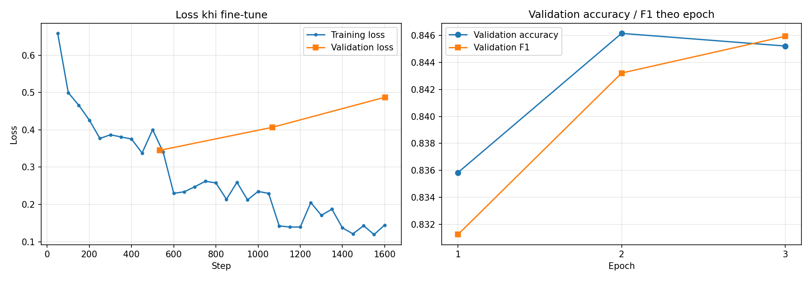

# Training — Fine-tune DistilBERT

## 1. Cấu hình huấn luyện

| Tham số | Giá trị | Ghi chú |
|---|---|---|
| Learning rate | 2e-5 | Mức thường dùng khi fine-tune BERT/DistilBERT |
| Batch size train / đánh giá | 16 / 32 | |
| Số epoch | 3 | |
| Weight decay | 0.01 | |
| Max length | 128 token | |
| Optimizer | AdamW | Mặc định của `Trainer` |
| Loss | Cross-entropy | `Trainer` tự dùng cho phân loại |
| Lịch learning rate | Giảm tuyến tính về 0 | Mặc định của `Trainer` |
| `eval_strategy` | `"epoch"` | Đánh giá trên **validation** sau mỗi epoch |
| fp16 | Bật khi có GPU NVIDIA | Nhanh hơn, ít tốn bộ nhớ GPU |
| Seed | 42 | `set_seed(42)` |
| Số bước mỗi epoch | 534 | 8.530 câu / batch 16 |

Transformers 5 dùng tên `eval_strategy` (không còn `evaluation_strategy`) và `processing_class=tokenizer` (không còn `tokenizer=`) khi tạo `Trainer`.

## 2. Notebook và script

| | `notebooks/ex2_finetuning.ipynb` | `src/train.py` |
|---|---|---|
| Theo dõi mỗi epoch | Validation | Validation |
| Lưu checkpoint | Không (`save_strategy="no"`) | Mỗi epoch (`save_strategy="epoch"`, giữ tối đa 2) |
| Model dùng để đánh giá | Cuối epoch 3 | Epoch có validation accuracy cao nhất (`load_best_model_at_end`) |
| Lưu model ra đĩa | Không | `models/distilbert-rotten-tomatoes/` |
| Kết quả ghi ra | Output trong notebook | `results/train_log.json`, `train_history.csv`, `loss_curve.png` |

Script giữ epoch tốt nhất vì validation loss tăng sau epoch 1 và validation accuracy cao nhất ở epoch 2 (mục 4); với số liệu lần 3, script sẽ chọn epoch 2.

## 3. Cách chạy

**Notebook:** mở trong VS Code, chọn kernel `.venv`, **Restart Kernel → Run All**.

**Script** (trong thư mục `LAB 3`):

```powershell
D:\Code\.venv\Scripts\python.exe -m src.train
```

Máy chỉ có CPU: đặt `$env:LAB3_TRAIN_LIMIT = "2000"` trước khi chạy để giới hạn số câu train.

## 4. Các lần chạy đã có

| Lần | Ngày | Phiên bản | Thiết bị | Epoch | Số bước | Thời gian train |
|---|---|---|---|---|---|---|
| 1 | 28/10 | Bản đầu (đánh giá trên test) | GPU RTX 3050 6GB | 3 | 1.602 | 118,6 giây |
| 2 | 30/10 | Bản tách validation/test | CPU | 1 (chưa chạy hết) | 534 | 1.177,7 giây (~19,6 phút) |
| **3** | **04/11** | **Bản hiện tại (tách validation/test) — kết quả chính thức** | GPU RTX 3050 6GB | 3 | 1.602 | 121,8 giây |
| 4 | 07/11 | Script `src.train` (giữ epoch tốt nhất, lưu model) | GPU RTX 3050 6GB | 3 (chọn epoch 2) | 1.602 | 131,5 giây |

**Quá trình học ở lần 3** (kết quả chính thức):

| Epoch | Training loss | Validation loss | Validation accuracy |
|---|---|---|---|
| 1 | 0.4002 | **0.3450** | 83.58% |
| 2 | 0.2297 | 0.4067 | **84.62%** |
| 3 | 0.1447 | 0.4874 | 84.52% |

Training loss giảm đều qua 3 epoch, nhưng validation loss thấp nhất ở epoch 1 rồi tăng → model bắt đầu **overfitting** từ epoch 2. Lần 1 (theo dõi trên test) cho cùng hình dạng: loss đánh giá 0.3625 → 0.4408 → 0.5470; training loss của lần 1 và lần 3 giống hệt nhau (cùng seed). Trên biểu đồ training loss có hai lần giảm mạnh quanh bước 534 và 1.068, đúng lúc bắt đầu epoch 2 và 3 (model gặp lại dữ liệu đã học).

**Lần 2** (bản tách validation/test, 1 epoch): training loss 0.3958, validation loss 0.3569.

**Lần 4 — script `src.train`** cho validation giống hệt lần 3 ở cả 3 epoch (loss 0.3450 / 0.4067 / 0.4874; accuracy 83.58% / 84.62% / 84.52%) và chọn **epoch 2** làm model tốt nhất, lưu vào `models/distilbert-rotten-tomatoes/`. Cột training loss của script (`results/train_history.csv`: 0.4307 / 0.2474 / 0.1500) là **trung bình các lần ghi log trong epoch**, còn bảng của notebook in **giá trị log cuối epoch** (0.4002 / 0.2297 / 0.1447), nên hai cột khác nhau dù cùng một quá trình huấn luyện.



Độ chính xác của các lần chạy: xem [evaluation.md](evaluation.md).

## 5. Lưu ý môi trường

- Train trên CPU chậm hơn GPU khoảng 30 lần ở bài này: 1 epoch mất ~19,6 phút trên CPU (lần 2), so với ~40 giây trên RTX 3050 (lần 1: 118,6 giây cho 3 epoch). Hai lần chạy trên hai máy khác nhau nên chỉ là ước lượng.
- PyTorch phải là bản CUDA (`torch.__version__` có đuôi `+cu126`); bản `+cpu` cho `torch.cuda.is_available() == False` dù máy có card NVIDIA.
- Khi cài lại torch trên Windows, phải tắt kernel Jupyter trước, nếu không sẽ báo `Access is denied` với `c10.dll`.
