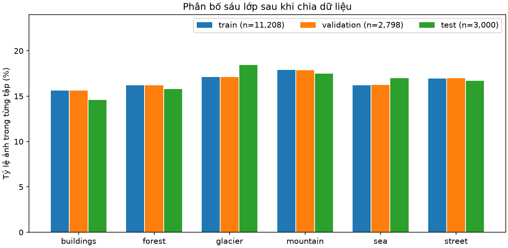
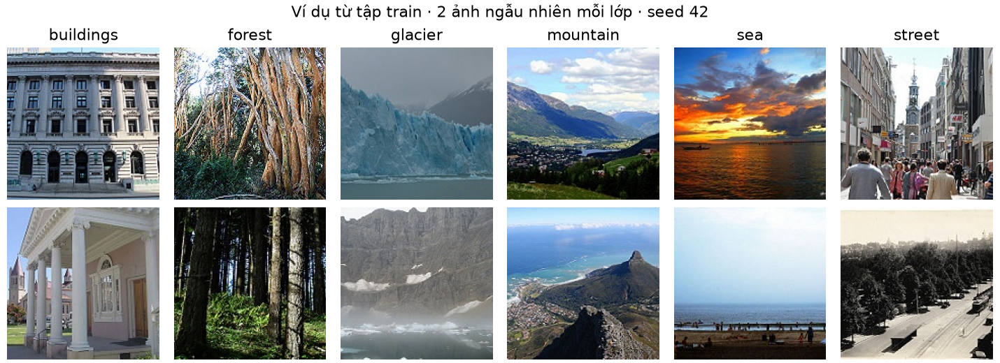
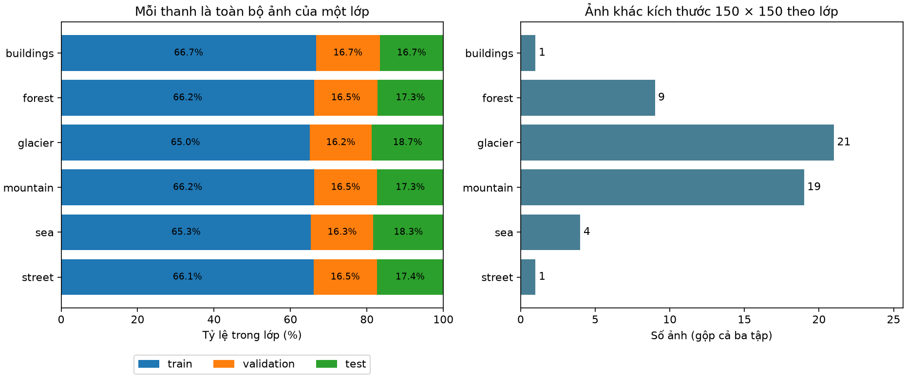
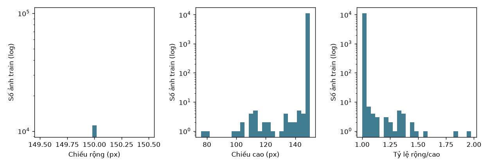
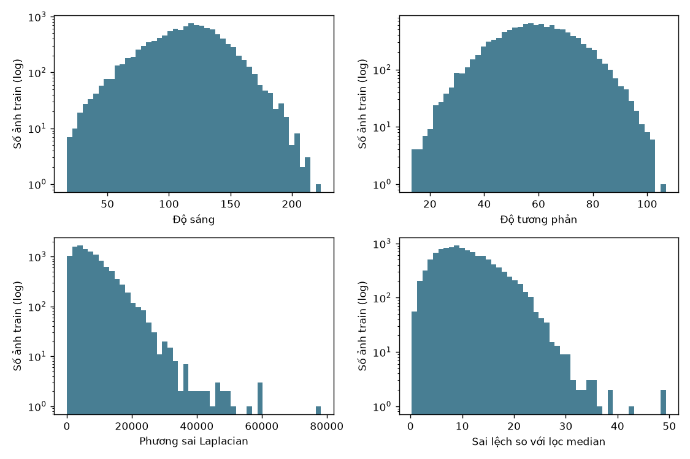
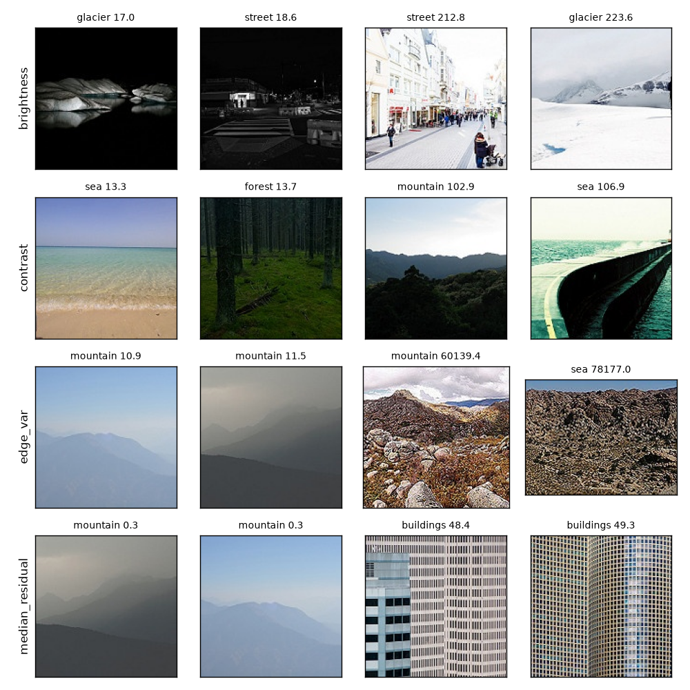
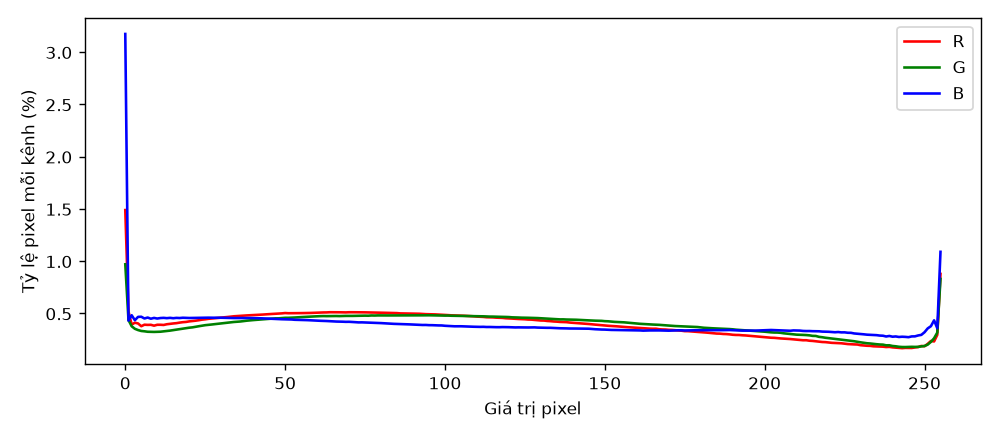
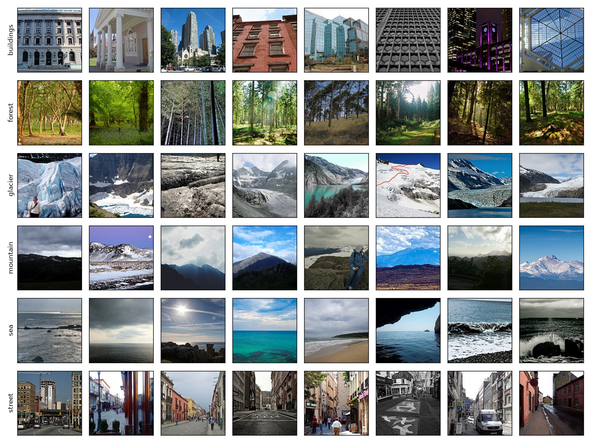
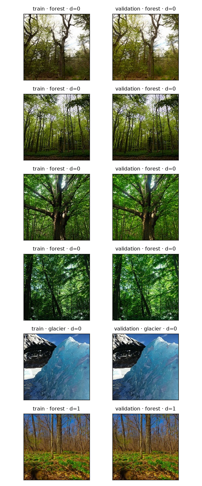

# EDA sau chia tập · Intel Image Classification

**Phạm vi:** báo cáo này ghi nhận bản chia ban đầu dùng để phát hiện ảnh gần trùng. Bản dùng để train và baseline sau khi xử lý được trình bày trong [báo cáo chia theo nhóm cảnh](../scene-review/report.md).

Nguồn: [Intel Image Classification trên Kaggle](https://www.kaggle.com/datasets/puneet6060/intel-image-classification/data). Thư mục local: `data/raw/intel-v2`. Kiểm kê bằng PIL trên toàn bộ 24.335 file xác nhận tất cả đều là JPEG, RGB và giải mã được. Có 14.034 ảnh trong `seg_train` (phát triển), 3.000 trong `seg_test` (đánh giá có nhãn), 7.301 trong `seg_pred` (demo không nhãn). [Danh sách lỗi giải mã](decode-errors.csv) rỗng ngoài dòng tiêu đề. Sáu tên thư mục lớp là nhãn của ảnh. Đếm và kiểm tra trùng trước khi chia, sau đó chỉ dùng train để đo đặc trưng ảnh phục vụ quyết định tiền xử lý. [Notebook đã dùng](../../notebooks/eda.ipynb).

Kết quả tính từ ảnh local bằng inspect_images và make_split (seed 42), trước huấn luyện. Tỷ lệ phần trăm dưới đây dùng tổng ảnh của từng cột làm mẫu số.

| Lớp | Train | Validation | Test |
|---|---:|---:|---:|
| buildings | 1750 (15.61%) | 437 (15.62%) | 437 (14.57%) |
| forest | 1816 (16.20%) | 453 (16.19%) | 474 (15.80%) |
| glacier | 1919 (17.12%) | 479 (17.12%) | 553 (18.43%) |
| mountain | 2004 (17.88%) | 500 (17.87%) | 525 (17.50%) |
| sea | 1818 (16.22%) | 454 (16.23%) | 510 (17.00%) |
| street | 1901 (16.96%) | 475 (16.98%) | 501 (16.70%) |
| **Tổng** | **11208** | **2798** | **3000** |

Lớp lớn nhất trong train là **mountain**. Baseline luôn đoán lớp này sẽ đúng **500/2798 = 17.87%** trên validation. Tỷ số số mẫu lớp lớn nhất/nhỏ nhất của train là 1.15. Mỗi lớp đều được đại diện và chênh lệch tỷ trọng lớn nhất giữa train và validation chỉ là 0.02 điểm phần trăm. Chưa có căn cứ từ số lượng lớp để áp dụng oversampling. Khi đánh giá cần xem thêm recall và F1 theo lớp.

| Tập | Ảnh 150×150 | Rộng min–max | Cao min–max | Chế độ màu |
|---|---:|---:|---:|---|
| train | 11168/11208 | 150–150 | 76–150 | {'RGB': 11208} |
| validation | 2790/2798 | 150–150 | 102–150 | {'RGB': 2798} |
| test | 2993/3000 | 150–150 | 72–150 | {'RGB': 3000} |

Kích thước đầu vào của hai model là 224×224. Resize giúp tạo batch đồng nhất nhưng không thêm chi tiết cho ảnh gốc nhỏ. Cần dùng cùng phép biến đổi xác định cho validation và test.

Đã giải mã 14034 ảnh development và 3000 ảnh test. Loại 28 ảnh development. Trong đó 23 ảnh thuộc nhóm mâu thuẫn nhãn. Trong 5 ảnh còn lại, 0 ảnh trùng test và 5 ảnh trùng nội bộ development. Ba tập không giao khóa RGB. Test giữ nguyên, có 0 bản lặp ngoài ảnh đầu tiên khi nhóm theo khóa RGB. Kiểm tra chỉ phát hiện ảnh giống hệt sau giải mã.

seg_pred có 7301 file, không có nhãn để tính phân bố lớp hay baseline.

Ảnh mẫu được chọn từ train. Bảng test chỉ mô tả thành phần dữ liệu, không dùng để chọn model hoặc siêu tham số.

## Phân bố trong từng lớp

Mỗi hàng lấy tổng ảnh có nhãn của chính lớp đó làm mẫu số. Test là tập có sẵn của dataset. Chỉ phần development sau làm sạch được chia 80/20 thành train và validation. Trong 55 ảnh có chiều cao dưới 150 pixel, 21 ảnh thuộc glacier và 19 ảnh thuộc mountain. Tất cả ảnh đều rộng 150 pixel. [Bảng từng kích thước theo lớp và split](theo-lop.csv).
## Kích thước, chất lượng và màu trên train

Trong train có 40 ảnh khác hình vuông. Ảnh rộng nhất so với chiều cao có tỷ lệ 150/76 ≈ 1,97. Resize theo cạnh ngắn giữ tỷ lệ, sau đó crop 224×224 có thể bỏ hai mép ảnh ngang. Cần đối chiếu ảnh trước/sau crop khi kiểm tra batch. Dùng cùng transform đánh giá cho cả hai backbone.

| Đại lượng trên mỗi ảnh train | P1 | Trung vị | P99 |
|---|---:|---:|---:|
| Sáng trung bình (0–255) | 40,4 | 116,4 | 182,2 |
| Độ tương phản (độ lệch chuẩn ảnh xám) | 27,0 | 59,1 | 91,5 |
| Phương sai Laplacian | 357,7 | 6.484,7 | 26.124,6 |
| Sai lệch tuyệt đối so với median 3×3 | 1,65 | 10,05 | 25,44 |

P1 và P99 là phân vị mô tả, không phải ngưỡng xóa. Hai ảnh có phương sai Laplacian thấp nhất là cảnh núi mờ trong sương. Hai ảnh có sai lệch median lớn nhất là mặt tiền tòa nhà với cửa sổ lặp lại. Loại mẫu theo một ngưỡng sẽ bỏ cả cảnh hợp lệ. Giữ các ảnh này. Nếu thử augmentation độ sáng về sau, chỉ quyết định dựa trên validation. [Chỉ số và đường dẫn từng ảnh](train-quality.csv).

Trên thang 0–1, mean RGB của toàn bộ pixel train là **(0,430; 0,457; 0,453)**, std **(0,269; 0,268; 0,298)**. Mỗi pixel đóng góp một lần, đo trước resize và augmentation. Hai mạng dùng chuẩn hóa tương thích trọng số ImageNet như description. Các số đo trên mô tả màu của Intel.

## Quan sát có đối chứng và bias

Lưới cố định 8 ảnh mỗi lớp cho thấy buildings và street đều có mặt tiền nhà, nhưng street thường có thêm vỉa hè hoặc lòng đường. Glacier và mountain đều có sườn núi, tuyết và trời xanh. Một ảnh glacier còn có đường vẽ đỏ trên tuyết. Đây là các giả thuyết để kiểm tra trong confusion matrix sau training. Không suy diễn tỷ lệ watermark hay nhãn sai từ 48 ảnh. Dataset không cung cấp group ID đáng tin cậy cho nguồn chụp, nên split theo lớp chưa chứng minh được độc lập theo người chụp hoặc địa điểm.

## Audit gần trùng và điều kiện trước normal run

Có **356 cặp ứng viên** trên 17.006 ảnh sau chia. dHash 64 bit dựa trên ảnh xám thu nhỏ, dùng khoảng cách Hamming ≤3. Có 191 cặp trong train, 7 trong test, 48 giữa train và validation, 96 giữa train và test, 14 giữa validation và test. Trong toàn bộ 356 cặp, 40 cặp có hai nhãn khác nhau. Đây là số cặp, một ảnh có thể xuất hiện nhiều lần. Khác nhãn là tín hiệu để rà soát. Không thể tự động xác định nhãn đúng từ hash. Phương pháp cũng có thể bỏ sót ảnh bị crop, lật hoặc chỉnh sửa mạnh. [Danh sách ứng viên](near-pairs.csv) · [Mẫu loại theo khóa RGB](exact-exclusions.csv).

Ở cả sáu cặp trong hình, vị trí thân cây, đường nét đỉnh núi hoặc khối băng khớp rõ giữa hai ảnh. Có bằng chứng trực quan về cảnh gần như lặp lại giữa train và validation dù khóa RGB khác nhau. Không dùng bản chia này để kết luận khả năng tổng quát hóa. Trước normal run, rà các cặp, gộp những ảnh được xác nhận cùng cảnh thành nhóm, ưu tiên giữ nguyên test và loại bản sao phía development nếu nhóm chạm test. Chia train/validation theo nhóm, sau đó đếm lại theo lớp, tính lại baseline, kiểm audit và lưu manifest mới. Đây là đề xuất xử lý tiếp theo, chưa áp dụng vào dữ liệu.

## Đối chiếu tám mục

| Mục | Bằng chứng | Kết luận |
|---|---|---|
| Tổng quan | Kiểm kê 3 thư mục và decode-errors.csv | 24.335 JPEG đọc được |
| Phân bố lớp | class-counts.csv, hai biểu đồ phân bố | Các lớp gần cân bằng |
| Kích thước | Histogram width/height/ratio, theo-lop.csv | Kiểm crop ở ảnh ngang |
| Chất lượng | Histogram và lưới cực trị | Giữ ví dụ tối/sương có ý nghĩa |
| Pixel và màu | Histogram RGB và mean/std chỉ từ train | Dùng chuẩn hóa pretrained |
| Quan sát | Lưới 48 ảnh train, seed 42 | Đánh giá lỗi glacier/mountain và buildings/street sau train |
| Trùng và nhãn | Danh sách exact và near-pairs | Còn các cặp cần xác minh theo nhóm |
| Leakage và bias | Cặp chéo split và quan sát lưới | Cần xử lý trước khi dùng split cho normal run |
