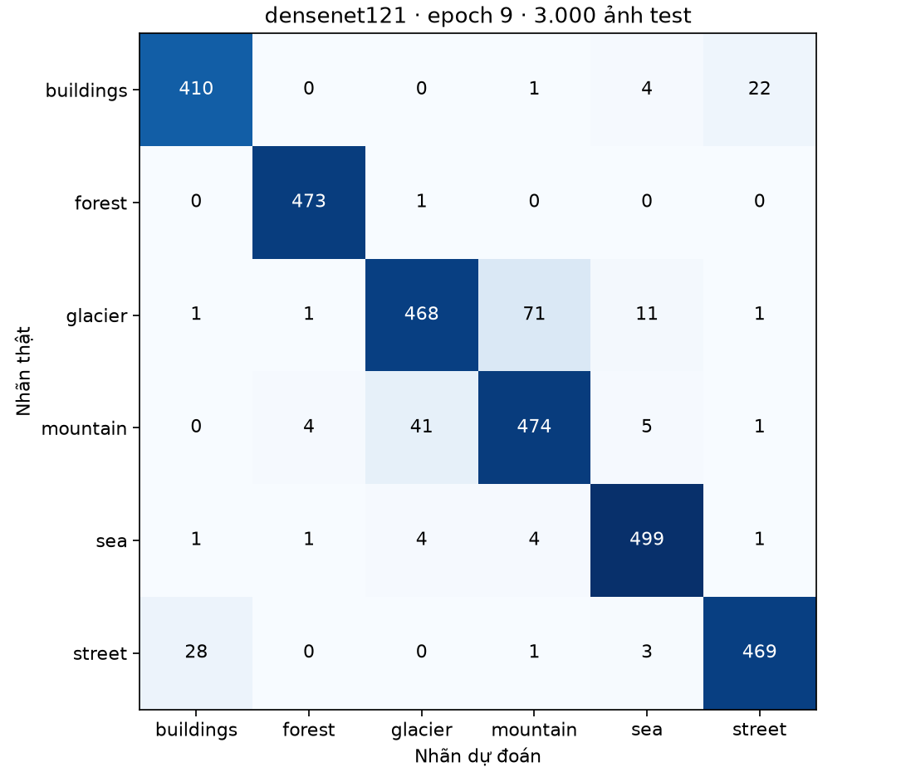
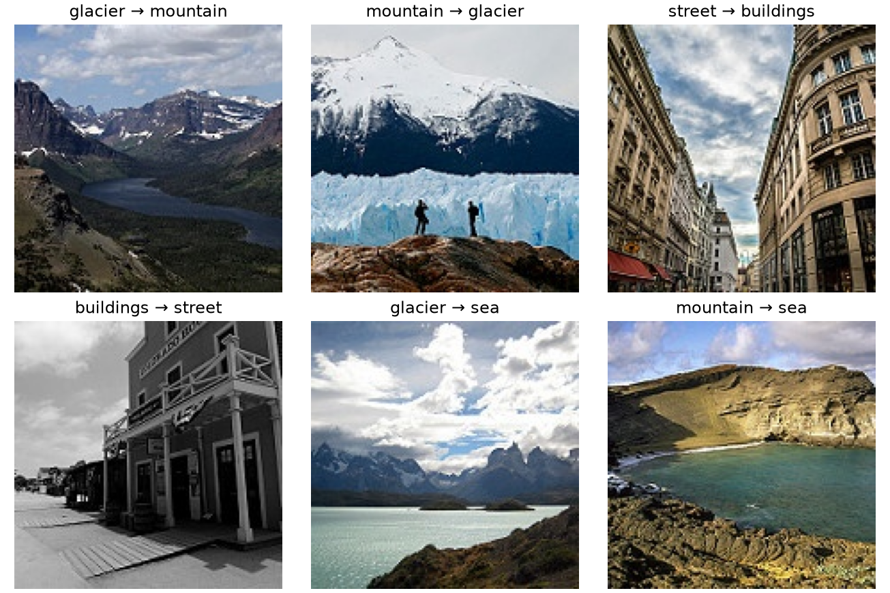

# P04 · Đánh giá DenseNet121 trên Intel Image Classification

Model chọn trước test: densenet121, epoch 9. Validation sau reload: 93.56%, loss 0.1878.
Test: đúng 2793/3000, sai 207, accuracy 93.10%, macro-F1 0.9326, loss 0.1870.

| Lớp | Precision | Recall | F1 | Số ảnh |
|---|---:|---:|---:|---:|
| buildings | 93.18% | 93.82% | 93.50% | 437 |
| forest | 98.75% | 99.79% | 99.27% | 474 |
| glacier | 91.05% | 84.63% | 87.72% | 553 |
| mountain | 86.03% | 90.29% | 88.10% | 525 |
| sea | 95.59% | 97.84% | 96.71% | 510 |
| street | 94.94% | 93.61% | 94.27% | 501 |

Các hướng nhầm nhiều nhất (nhãn thật → dự đoán): glacier → mountain: 71, mountain → glacier: 41, street → buildings: 28, buildings → street: 22, glacier → sea: 11.

Macro-F1 lấy trung bình F1 của sáu lớp. Loss là cross-entropy trung bình theo ảnh. Tập test đã từng được xem ở lần làm Lab trước. Kết quả mô tả một seed và bản chia hiện tại.
