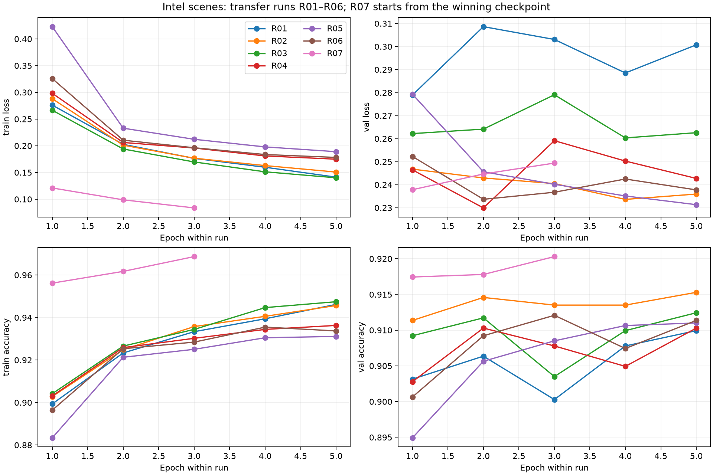
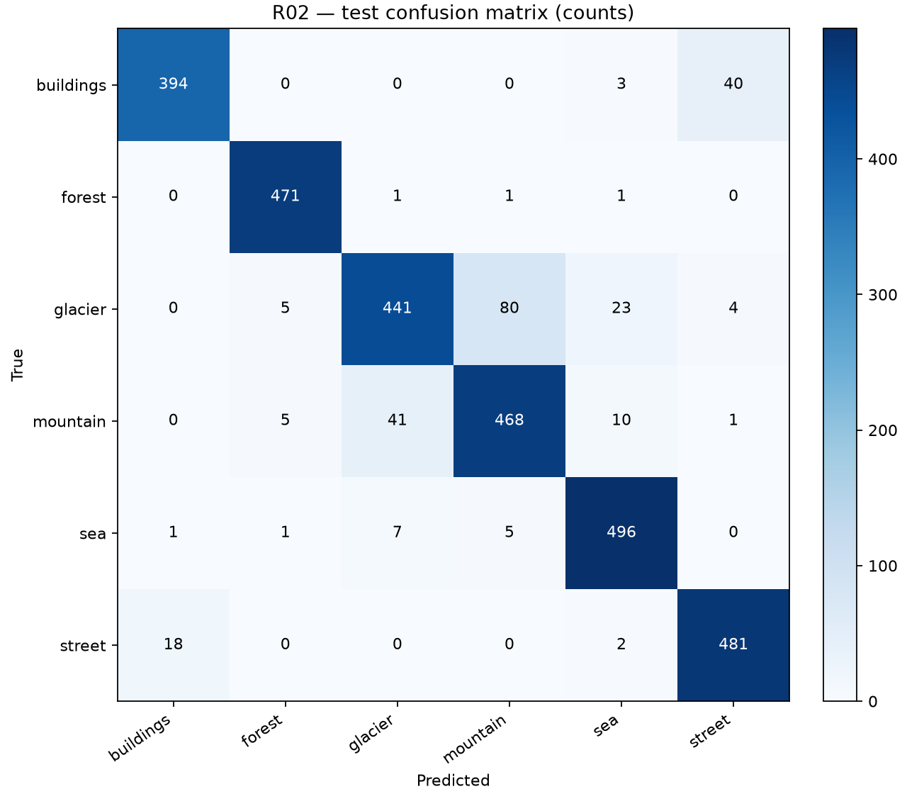
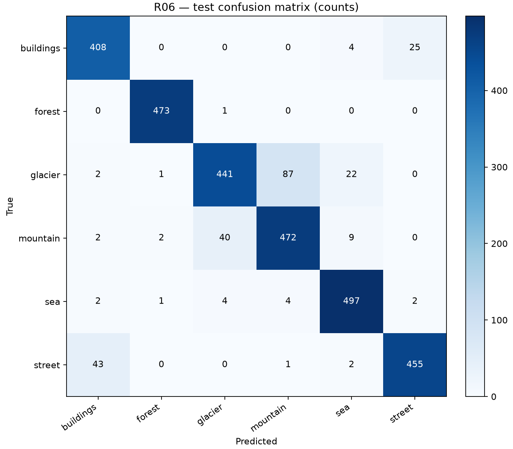

# Practice 2 — Pretrained neural networks: Intel Image Classification

Hoàn tất: 2026-10-30T08:10:54.217819+00:00. Thiết bị của toàn bộ ma trận: **xpu**.

## Dữ liệu và phương pháp

Dataset Kaggle Intel Image Classification v2: 14034 ảnh train gốc, 3000 ảnh test và 7301 ảnh chưa gán nhãn (không dùng chấm điểm).
Sau kiểm tra SHA256/nhãn: train **11208**, validation **2798**, test **3000**. Loại 28 bản ghi train do trùng, chồng lấn test hoặc nhãn mâu thuẫn; không sửa dữ liệu gốc.
13 nhóm ảnh có nhãn mâu thuẫn: cách ly 23 ảnh train; giữ nguyên test. Xem `../data/label_conflicts.json` và amendment 01. Train/validation/test không giao SHA256. Chia phân tầng seed 42, validation 20% làm tròn xuống theo lớp.
Ảnh RGB được resize cạnh ngắn 256, crop 224 và chuẩn hóa ImageNet. Train dùng random crop/flip; validation/test dùng center crop. Adam, float32, num_workers=0, không bỏ batch cuối.
Trọng số ImageNet1K_V1 của torchvision; thay đầu ra bằng 6 lớp. Transfer chỉ cập nhật linear cuối. Fine-tune mở block cuối cùng và linear cuối. Giữ dropout/BatchNorm ở eval trong mọi run để backbone cố định đúng nghĩa; affine của BN trong block mở vẫn nhận gradient.
R01–R06: 5 epoch từ cùng weights và seed 42; mỗi cặp LR/batch chỉ thay một yếu tố. R07: 3 epoch bổ sung từ checkpoint validation tốt nhất, Adam mới lr 1e-5. Lựa chọn theo accuracy validation giảm dần, rồi loss, epoch và run ID tăng dần.

## Kiến trúc

| Model / mode | Tổng tham số | Trainable |
|---|---:|---:|
| vgg11 / transfer | 128,790,918 | 24,582 |
| vgg11 / finetune | 128,790,918 | 4,744,198 |
| densenet121 / transfer | 6,960,006 | 6,150 |
| densenet121 / finetune | 6,960,006 | 2,166,278 |

Cấu trúc đầy đủ và tên các tham số trainable: `../models/`.

## Thí nghiệm validation

| Run | Model | Mode | LR | Batch | Best epoch | Val accuracy | Val loss | Phút train+val |
|---|---|---|---:|---:|---:|---:|---:|---:|
| R01 | vgg11 | transfer | 0.001 | 8 | 5 | 90.99% | 0.3007 | 19.5 |
| R02 | vgg11 | transfer | 0.0003 | 8 | 5 | 91.53% | 0.2359 | 18.0 |
| R03 | vgg11 | transfer | 0.001 | 16 | 5 | 91.24% | 0.2626 | 16.6 |
| R04 | densenet121 | transfer | 0.001 | 8 | 2 | 91.03% | 0.2299 | 17.7 |
| R05 | densenet121 | transfer | 0.0003 | 8 | 5 | 91.10% | 0.2313 | 19.5 |
| R06 | densenet121 | transfer | 0.001 | 16 | 3 | 91.21% | 0.2367 | 16.7 |
| R07 | vgg11 | finetune | 1e-05 | 8 | 3 | 92.03% | 0.2494 | 14.3 |

## Nhận xét từ số đo

- vgg11: giảm LR 0.001 → 0.0003 thay đổi validation accuracy +0.54 điểm phần trăm; tăng batch 8 → 16 thay đổi +0.25 điểm phần trăm (so với R01).
- densenet121: giảm LR 0.001 → 0.0003 thay đổi validation accuracy +0.07 điểm phần trăm; tăng batch 8 → 16 thay đổi +0.18 điểm phần trăm (so với R04).
- Fine-tune R07 so với checkpoint cha R02: +0.50 điểm phần trăm validation. R07 có thêm ngân sách 3 epoch nên đây không phải so sánh ngang ngân sách.
- Model cuối được chốt bằng validation trước khi test: **R07**; best transfer: **R02**.

## Đánh giá test sau khi khóa lựa chọn

| Run | Test accuracy | Macro-F1 | Loss | Số ảnh |
|---|---:|---:|---:|---:|
| R02 | 91.70% | 0.9186 | 0.2132 | 3000 |
| R06 | 91.53% | 0.9168 | 0.2230 | 3000 |
| R07 | 92.80% | 0.9297 | 0.2033 | 3000 |

Precision, recall, F1 và support từng lớp trong `per_class_metrics.csv`; zero division = 0. Dự đoán từng ảnh nằm trong các file `*_predictions.csv`.

## Giới hạn và khả năng tái lập

- Chỉ một seed, chưa đo độ biến thiên qua nhiều lần chạy. Không suy rộng chênh lệch nhỏ thành kết luận thống kê.
- Dataset có nhãn mơ hồ và ảnh trùng. SHA256 chỉ phát hiện trùng byte, không phát hiện tất cả ảnh gần giống.
- Thời gian đo trên laptop Intel Arc dùng bộ nhớ chung; chịu ảnh hưởng nhiệt độ và tiến trình khác. Thời gian trong bảng chỉ gồm vòng train/validation, không gồm tải, khởi tạo hay ghi checkpoint.
- XPU không được cam kết tái lập bitwise. Checkpoint lưu RNG, optimizer, config, source/data/dependency hashes để resume cùng môi trường.
- Test không dùng điều chỉnh siêu tham số; model cuối không chọn theo test accuracy.

## Artifacts

`experiments.csv`, `epoch_metrics.csv`, `test_metrics.csv`, `per_class_metrics.csv`, `summary.json`; checkpoint/TensorBoard/identity theo từng run trong `../experiments/`.
Nguồn dataset: https://www.kaggle.com/datasets/puneet6060/intel-image-classification/data. Weight provenance: `../models/weights.json`.
