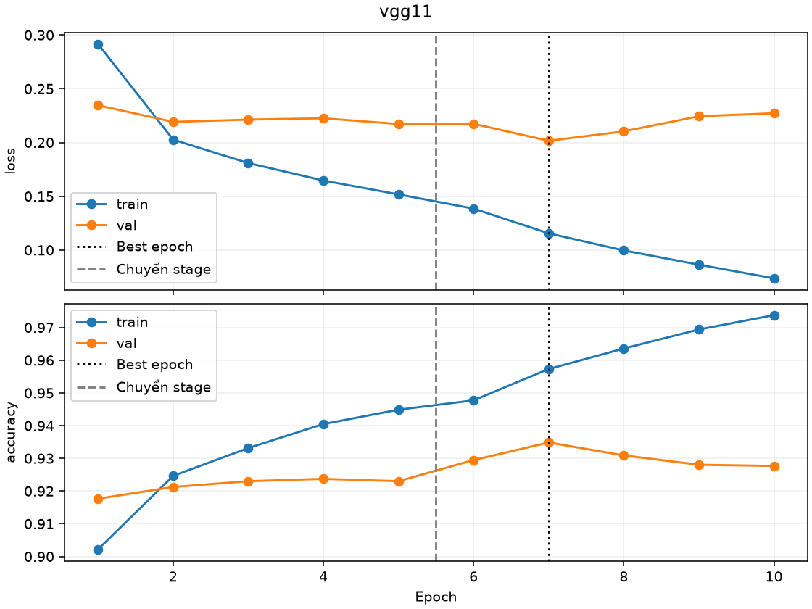
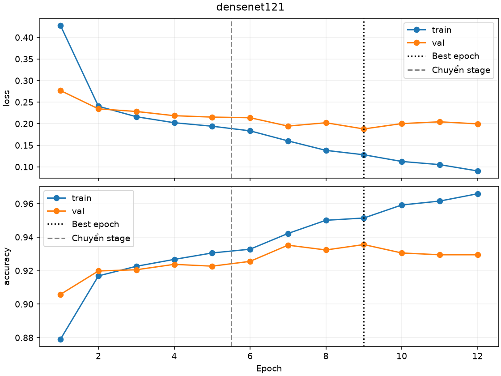
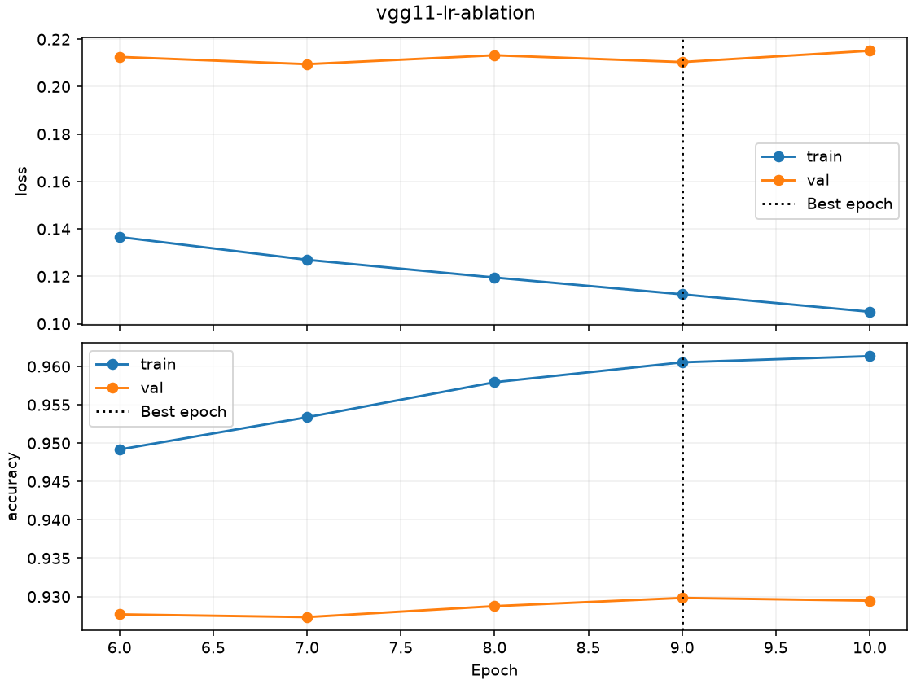

# Huấn luyện trên bản chia theo nhóm cảnh

Mỗi epoch dùng 11.173 ảnh train và 2.793 ảnh validation. Test giữ cho bước đánh giá sau khi khóa lựa chọn.

| Run | Epoch thực chạy | Epoch tốt nhất | Số đúng / 2.793 | Accuracy | Loss | Lý do dừng |
|---|---:|---:|---:|---:|---:|---|
| vgg11 | 10 | 7 | 2611 | 93.48% | 0.2016 | early_stopping |
| densenet121 | 12 | 9 | 2613 | 93.56% | 0.1878 | early_stopping |
| vgg11-lr-ablation | 5 | 9 | 2597 | 92.98% | 0.2104 | early_stopping |

Chọn **densenet121** bằng validation trong hai run chính. Nhánh VGG LR thấp chỉ dùng phân tích.

